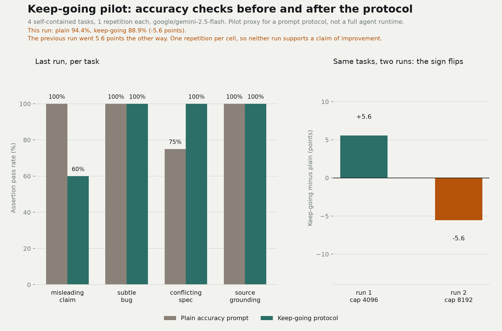

# keep-going

Accuracy beats speed. The skill exists because most agent failures are not knowledge failures but stopping failures: the model answers the first plausible thing, never checks the number, and never asks a second pass to break it. The `keep-going` skill turns one long answer into a loop with acceptance checks, evidence, an independent reviewer, and a budget, so a task keeps going until the blocking findings are gone or the budget is spent.

Every round asks the same three questions: what is the evidence, who is checking it, and what happens if the check fails.

## What it enforces

- Acceptance checks written before any work starts.
- Evidence for every factual claim, with unknowns marked `UNVERIFIED`.
- A separate implementer pass and a separate reviewer pass, and subagents when the harness has them.
- A round log on disk, so that a context reset does not lose what the previous round proved.
- A budget of three rounds.
- A final report that separates what is verified from what is still open about it.

The reviewer pass is the part that earns its cost. It is told to assume the work is wrong, which is a different instruction from "check your work". It is also the reason the budget can stop early: once a fresh pass finds nothing blocking, another round adds tokens without adding evidence.

## Install

Copy or symlink the skill into an agent skills directory:

```sh
# Global, cross-runtime
cp -r /path/to/keep-going ~/.agents/skills/keep-going

# Or keep this repo and symlink
ln -s /path/to/keep-going ~/.agents/skills/keep-going
```

Load it as `keep-going` (or the directory name your runtime uses).

## Repo layout

```text
keep-going/
  SKILL.md
  README.md
  LICENSE
  eval/
    tasks.ts
    run.ts
    selfcheck.ts
  docs/
    results.md
    interpretation.md
    keep-going-log.md
    design.md
    diagrams/
      pilot.png
      runs.json
      make_diagrams.py
```

## Pilot evaluation

The pilot does not claim a universal improvement. It measures a narrow proxy: the keep-going protocol prompt against a plain accuracy prompt on four self-contained tasks with objective assertions, one repetition each. The tasks include a misleading claim, a subtle bug, conflicting requirements, and a source-grounding check.

Run:

```sh
node --experimental-strip-types eval/selfcheck.ts
node --experimental-strip-types eval/run.ts
python3 docs/diagrams/make_diagrams.py
```

The runner reads credentials from the OpenCode auth store, or from `KEEP_GOING_API_KEY` with `KEEP_GOING_PROVIDER=google` for the Google Generative Language API. Results are written to `docs/results.md` and `eval/out/pilot.json`.

## Results



The last run on `google/gemini-2.5-flash`: plain passed 17 of 18 assertions, keep-going passed 16 of 18. The run before it, same tasks, same model, scored 17 and 18. The difference changes sign between runs. One repetition per cell cannot tell chance from effect. `docs/interpretation.md` walks through which answer got what wrong, why the protocol did not stop one of those errors, and what a measurement with more tasks and more repetitions would have to look like before anyone could call this an improvement.

## What the pilot cannot tell you

Four tasks, one repetition, and a prompt-only contrast do not add up to a benchmark. The numbers show whether the protocol changed the answers on these four tasks. They say nothing about how the protocol behaves across a real project, where the research, the reviewer and the budget all cost time on things that turn out to be fine.

So every round asks the same three questions: what is the evidence, who is checking it, and what happens if the check fails. When the answers stop changing, the loop stops.

See `docs/results.md` for the measured numbers and the limitations that come with four tasks and one repetition.
