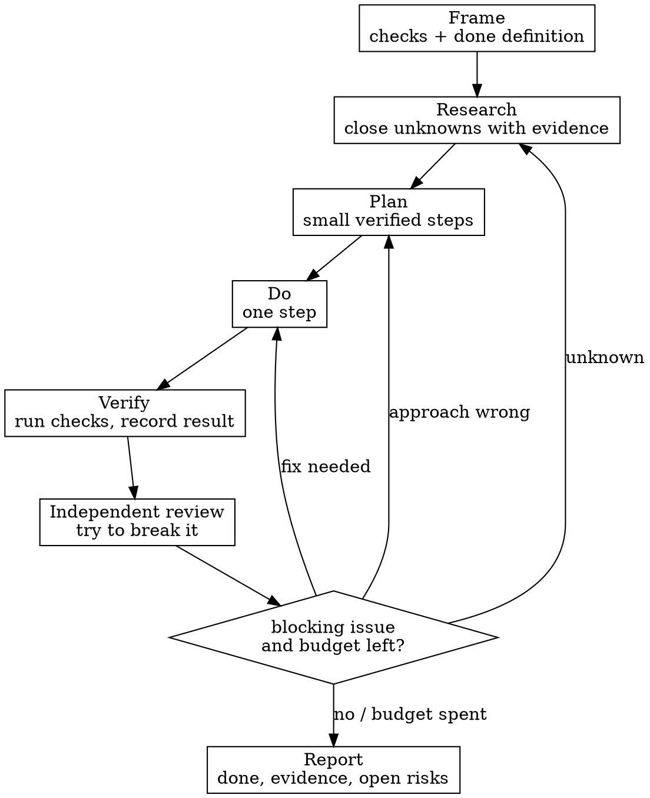

# Keep Going

## Overview

Accuracy beats speed. For one task, do not stop at the first answer that looks right. Write the checks first, close the open questions with evidence, plan, do the work, then hand it to a separate reviewer whose job is to break it. Repeat while a blocking issue remains and the round budget is not spent.

**Core rule:** no claim without evidence, no done without a failing-then-passing check or a written verification record.

## When to use

- The user says "keep going", "be thorough", "double check", "verify", "accurate", "no mistakes", or asks for agents to supervise each other.
- The cost of a wrong answer is higher than the cost of extra time: facts, numbers, dates, sources, security, money, migrations, data loss, public claims, or tricky bugs.
- The task crosses domains: research plus implementation, code plus docs, behavior plus tests.

**When not to use:** quick lookups the user asked to answer fast, throwaway drafts, or work where the user explicitly chose speed. If the user says "fast" or "just do it", follow that.

## The loop



## Round log (required)

Keep a small log on disk so a reset does not lose state. Default path: `docs/keep-going-log.md` in the current project, or `/tmp/keep-going-<topic>.md` when there is no project.

For each round record:

```md
## Round N
- Goal:
- Checks written:
- Evidence gathered: (file, command, URL, or "UNVERIFIED")
- Change made:
- Verification result:
- Reviewer findings: blocking / non-blocking / none
- Decision: continue because ... / stop because ...
```

## Roles

Use separate passes. With a `subagent` tool, give each pass a narrow job and fresh instructions; do not ask one pass to both produce and approve its own work.

| Role | Job | Must return |
|---|---|---|
| Researcher | Find facts, prior art, constraints, and counterexamples. | Claims with sources; unknowns labeled `UNVERIFIED`. |
| Planner | Turn checks and evidence into the smallest complete sequence. | Ordered steps, risk per step, how each step is verified. |
| Implementer | Do one planned step. | The change, files touched, exact verification command/output. |
| Reviewer | Assume the work is wrong until proven otherwise. | Blocking findings, edge cases, missing evidence, suggested check. |
| Judge (optional) | Resolve disagreements between implementer and reviewer. | Decision with reason and the deciding evidence. |

A single agent may play roles only when no subagent tool exists. In that case, separate them by writing: finish the implementer pass, write the reviewer pass as if you did not write the code, then answer the findings.

## Checks before work

Before research or implementation, write the acceptance checks:

- Facts: the claim, the source, and what would falsify it.
- Code: the test, command, or assertion that fails before the fix and passes after.
- Writing or analysis: the required points, the forbidden claims, and how each point is supported.

If you cannot write a check, write why, and treat the result as lower confidence.

## Research rules

1. Prefer primary sources: code, docs, RFCs, vendor docs, papers, command output, file contents.
2. Read enough to answer the question, not everything on the topic.
3. Record the source for each factual claim. A date, version, number, or quote without a source is `UNVERIFIED`.
4. Search for the failure case: "what breaks", "known issue", "edge case", "counterexample", "CVE", version incompatibility.
5. When sources disagree, report the disagreement and the deciding evidence; do not pick the convenient one silently.

## Plan rules

- Plan the smallest change that satisfies every acceptance check.
- Name what is out of scope.
- Put verification after each risky step, not only at the end.
- If a step depends on an unknown, move research before that step.

## Verification rules

Verification is evidence, not confidence.

- Run the checks you wrote. Paste or summarize the exact result.
- Re-read the relevant code or text after changes; do not trust memory.
- Check callers, tests, config, and user-facing behavior touched by the change.
- For facts, confirm the load-bearing claim against its source again after drafting.
- A check that was not run is not a pass.

## Reviewer rules

The reviewer looks for what the implementer missed:

- Wrong claim, missing source, stale version, or invented detail.
- Off-by-one behavior, empty/error paths, boundary values, encoding, time zones, permissions.
- A fix that passes the narrow test but breaks an existing caller or contract.
- A report that sounds certain where the evidence is thin.

Findings must be specific: location, what is wrong, impact, and the check that would expose it. "Looks fine" is not a review.

## Budget and stop

Default budget: **3 rounds** after the first implementation, or when two consecutive rounds produce no new blocking findings. Stop earlier when every acceptance check passes and the reviewer has no blocking finding.

When budget is spent with open issues, stop and report:
- what is verified,
- what is still open,
- the exact next check or source needed.

Never claim completion with an open blocking finding.

## Reporting

End with a short report:

1. Result: done, or not done and why.
2. Evidence: checks run, key sources, commands, files.
3. Review: who or what reviewed it, and the blocking and non-blocking findings.
4. Risks left: only real ones, tied to missing evidence or checks.

## Red flags

| Thought | Reality |
|---|---|
| "The first answer is probably right." | Treat it as a draft until checked. |
| "I remember this API/date/number." | Memory is not evidence. Verify it. |
| "The reviewer agrees." | Agreement is cheap. Ask for a breaking case. |
| "One more round might help." | Check the budget. Report open risks instead of looping forever. |
| "I can skip the log." | The log is how the next round avoids repeating work. |

## Example

Task: "Is library X safe to upgrade?"

1. Checks: current version, target version, changelog breaking changes, known advisories, test suite or smoke command.
2. Researcher records sources for each; unknown advisory status is `UNVERIFIED`.
3. Planner orders: confirm versions, read release notes, search advisories, run tests in a branch/worktree.
4. Implementer makes the smallest upgrade and runs the checks.
5. Reviewer looks for transitive breaks, config changes, and unrun test areas.
6. Report states pass/fail, evidence, and any unverified risk.
